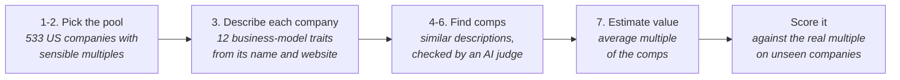

# Qual2Cast

**Valuing private companies from what they say about themselves in public.**
*Columbia University IEOR Industry Capstone, in partnership with Rational AI (Fall 2026).*

Private companies don't publish their financials, so it's hard to say what they're worth. They do have a public
trail: a website, press releases, job posts. Qual2Cast uses that trail to find **comparable public companies
("comps")**: businesses that do similar things and whose market value is known. The comps' valuation multiples
then give an estimate for the private company.

To check that this works, we test it on 560 **public** companies, treating each one as if it were private. Because
their real multiples are known, every estimate can be scored against the right answer. Every automated step,
including the AI models, is scored this way rather than trusted.

_Last updated 2026-11-03._

---

## How it works

The method follows a seven-step recipe from our mentor, Aziz Lookman (Rational AI):

1. **Pool of candidates.** Start from the 560 companies, keep US-headquartered firms, and drop those with extreme
   multiples (EV/EBITDA outside 3-30). 533 remain.
2. **Describe each business.** An AI model fills in twelve *facets* for each company (what it sells, to whom, how
   it earns money, where, and so on) from its name and website only. No financial figures are used.
3. **Find comps.** Companies whose facet descriptions are most alike become candidates. We compare four ways of
   choosing among them: pure similarity, similarity then an AI judge, the AI choosing directly, and the AI choosing
   then similarity re-ranking.
4. **Estimate and score.** The target's multiple is estimated as a weighted average of its comps' multiples, then
   compared with its real multiple. The baseline to beat is *no matching at all* (the average of every company).

To keep the test honest, the companies are split once into a **training set (373)** used to build the method and a
**holdout set (160)** used only to score it.

## Where things stand

| part | status |
|---|---|
| Company list and website text | **Done.** 560 companies; 532 websites gave usable text. |
| Facets (company descriptions) | **Done** for all 533 firms. A hand check found problems in about 1 in 4 checkable facets; size and geography are the weakest. |
| Finding comps (four routes) | **Done and scored** on the 160 holdout companies. |
| Human review of comps | **Done for two targets** (Paylocity and Wendy's, 36 candidate pairs, three reviewers). Reviewers fully agreed on only 11 of 36. **Round 2 is ready to fill:** five more targets, 67 pairs ([`v1/GOLDEN_SET_ROUND2.md`](v1/GOLDEN_SET_ROUND2.md)). |
| Sector-specific facets | **Done.** Small, not-yet-certain improvement for the similarity route. |
| Weighting the facets (v1) | **Adopted as the v1 baseline ("B3")**, see [`v1/notebooks/similarity_methods.ipynb`](v1/notebooks/similarity_methods.ipynb). It finds better-fitting comps by the reviewers' and the AI judge's grades, but the estimates are no more accurate. |
| Revenue-growth forecast | **Not started** (an earlier signal collector is in `pre-v0/`). |

**What the results say so far.** With no matching, the median estimate is off by about 40%. The comp routes land at
about 33-38%. That is better, but the statistical intervals overlap, so no route is a clear winner yet. Adding
sector-specific facets moves the similarity route from 37.3% to 35.0%, again not yet certain. The holdout has now
been used for many comparisons, so a final score needs a fresh set of companies.

## What's in this repository

| folder or file | what it is |
|---|---|
| [`v1/`](v1/README.md) | **The current working version.** A copy of v0 to keep building on. `notebooks/` are the step-by-step analyses; `scripts/` is the code they use. |
| [`v0/`](v0/README.md) | **The 2026-10-28 deliverable**, kept unchanged as a record. Start with [`notebooks/comps_and_valuation.ipynb`](v0/notebooks/comps_and_valuation.ipynb) (main results) and [`notebooks/gold_and_holdout_integration.ipynb`](v0/notebooks/gold_and_holdout_integration.ipynb) (human review and holdout report). |
| [`website_scrape/`](website_scrape/README.md) | Collects each company's website text and removes financial and stock-market language. |
| `data-local/` | The input company list (snapshots, never edited by hand). |
| `outputs-local/` | Results of every step: tables, AI prompts and answers. The current work is in `outputs-local/v1/`, shared through Git ([map](outputs-local/v1/README.md)). |
| `src/`, [`docs/`](docs/data_dictionary.md) | Shared code for loading data; column definitions and known data issues. |
| [`PROJECT_STATE.md`](PROJECT_STATE.md) | Running log of decisions, status and open questions. |
| `conversations/` | Handoff notes: what each work session changed and what's next. |
| [`pre-v0/`](pre-v0/README.md) | Earlier work from before the recipe (before 2026-10-21), kept for reference only. |
| `AGENTS.md`, `CLAUDE.md` | Working rules for teammates and AI coding assistants. |

## Getting started (for teammates)

1. Install [uv](https://docs.astral.sh/uv/getting-started/installation/) (Windows or Mac).
2. From the repository folder, run `uv sync`. This creates the same Python 3.12 environment on every machine.
3. In VS Code or Jupyter, choose `.venv` as the notebook kernel, then open a notebook in `v1/notebooks/`.

Run tests with `uv run pytest v1/scripts/tests -q`. Add a package with `uv add <name>`. Optional extras:
`uv sync --extra scrape` (website scraper), `uv sync --extra pre-v0` (earlier matching work).

## Project rules

- **It must work for a private company.** For the target we use only its name, website and three figures a buyer
  would know: last-twelve-months revenue, EBITDA and debt. Public comps may use more (e.g. annual reports).
- **The multiple is the answer, never an input.** EV/EBITDA is what we estimate, so it can't be used to pick comps.
- **Data is collected by code, never typed in.** Unknowns are marked unknown, and facts cite their source.
- **Nothing is overwritten.** Every step's data is kept, including AI prompts and answers.

Full working rules: [`AGENTS.md`](AGENTS.md).

## Team contributions

- **Michael:** the recipe pipeline and baseline (pool, facets, training/holdout split, valuation), the human-review
  sheet and its scoring, the v1 working copy and shared environment.
- **Yikai:** the four comp-finding routes, the full holdout evaluation, the graded AI judge, and the business-structure
  analysis.
- **Fiona:** sector groups and sector-specific facets, and tests of which facets help.
- **Yiming:** checking facets against outside evidence (saved pages, deeper site crawl, web search).
- **Yifan and Richard:** evidence retrieval for facet checks, and converting the team's 40-company label sheet.
- **Kethan:** an AI judge that must cite evidence from both companies.
- **Riya, Barbara and Matthew:** independent human reviews of the comps; Riya also labelled 40 companies' facets.

## Next steps

1. **More human reviews** of comps: round 2's sheet (five targets) is ready; see [`v1/GOLDEN_SET_ROUND2.md`](v1/GOLDEN_SET_ROUND2.md).
2. **A fresh test set** (e.g. a wider set of companies), with the method fixed in writing before it is scored.
3. **Better estimates:** pulling estimates toward the overall average, using size as a secondary check, and flagging
   companies with no good match.
4. **Better facets:** fix the weak ones (size, geography, businesses a company has sold) and try new ones.
5. **Growth forecast,** then the final report and presentation.

## Terms

| term | meaning |
|---|---|
| **Comps** | Comparable public companies, used as a pricing reference. |
| **EV/EBITDA** | Company value (including debt) divided by yearly operating earnings. A company earning $10M at 12× is worth about $120M. |
| **Facet** | One trait of a business model, e.g. "who the customers are" or "how revenue is earned". |
| **AI judge** | A language model asked to accept or grade a proposed comp, with reasons. |
| **Training / holdout** | Companies used to build the method / companies kept aside to test it fairly. |
| **Median error** | How far estimates are from the real multiple, in %, for the typical company. |
| **SIC code** | A government industry code (e.g. 7372 = software). Used here only as a check. |

## Acknowledgments

Developed under the guidance of Aziz Lookman, founder of Rational AI.
