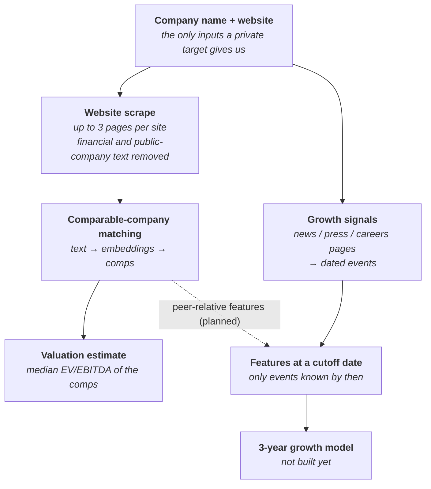

# Qual2Cast

**Forecasting private-company revenue growth from qualitative signals.**
*Columbia University IEOR Industry Capstone, in partnership with Rational AI (Fall 2026).*

Private companies don't publish audited financials, so it's hard to estimate how fast they'll grow or what they're worth. They do leave a public trail: their own website, press releases, job posts, news. Qual2Cast turns that trail into numbers a model can use, with two aims:

1. **Find comparable public companies ("comps")** for a private company from its website alone, and use the comps' valuation multiples to estimate the private company's value.
2. **Forecast 3-year revenue growth** from dated events such as new contracts, hiring, layoffs, launches and credit trouble.

Every automated step, including any language model, is treated as a system under test: it's scored against known answers, and its errors are counted rather than trusted away.

_README last updated 2026-10-24: work from before v0 moved into `pre-v0/`. Times below are US Eastern (UTC−4)._

**Current method (v0):** the mentor's recipe for comps, in [`v0/`](v0/README.md); start with
[`v0/notebooks/comps_and_valuation.ipynb`](v0/notebooks/comps_and_valuation.ipynb).

**Evaluate the cosine → LLM peers:** continue in
[`v0/notebooks/peer_evaluation.ipynb`](v0/notebooks/peer_evaluation.ipynb).
It grades accepted pairs against saved website passages on a 0–3 rubric using
Codex CLI or Claude Code CLI. The matching notebook's final cell exports its
input handoff. [Setup and interpretation](v0/PEER_EVALUATION.md).

**Team report (2026-10-20, before v0):** read the [four-page research memo](pre-v0/reports/team_company_workflow/team_research_memo.pdf)
and [contribution/evidence appendix](pre-v0/reports/team_company_workflow/team_research_appendix.html).
The memo reports the original team experiments alongside the newer integrated
workflow, with matching samples and explicit evaluation limits.

**Integrated workflow (before v0):** start with the [standalone notebook](pre-v0/notebooks/team_company_workflow.ipynb)
or the [results and figures](pre-v0/reports/team_company_workflow/README.md).
The [module guide](pre-v0/pipeline/TEAM_WORKFLOW.md) explains setup, method selection and
integration with the existing website, matching and growth modules. Default execution
replays recorded inference and recomputes downstream results. Business review is
mandatory before financial ranking; independent human validation remains pending.

---

## Where things stand

| part | state on `main` | where |
|---|---|---|
| Company list | **Done.** 560 US public companies, used as stand-ins for private targets. | `data-local/snapshots/`, `data_manifest.json` |
| Website scrape | **Done for all 560.** 532 sites gave usable text. | `website_scrape/` |
| Comps recipe (v0) | **Steps 1-7 built (2026-10-25).** The mentor's recipe: universe and EV/EBITDA 3-30 range (533 firms), twelve facets filled by Claude Haiku 5.5, a 70/30 training/holdout split, candidates by facet embeddings, an LLM good/bad step and an LLM that picks comps directly, and estimates against the actual multiples. Every way of choosing comps lands at about 30-33% median error on the training targets (no matching: 32.7%). Holdout not scored yet; evals next. | `v0/` |
| Comparable-company matching | **Three methods built and scored on all 535 usable companies.** Picking comps from website text finds real peers but doesn't yet beat a no-matching estimate on valuation error. | `pre-v0/matching/` |
| Ten-company research pilot | **Frozen comparison** of 31 ways to rank peers, on ten companies. Human review still pending. | `pre-v0/notebooks/`, `pre-v0/experiments/`, `pre-v0/reports/` |
| Integrated team workflow | **Staged company workflow and team memo** (Yikai, on main 2026-10-20). | `pre-v0/pipeline/`, `pre-v0/valuation/`, `pre-v0/notebooks/team_company_workflow.ipynb`, `pre-v0/reports/team_company_workflow/` |
| Growth signals | **Revised 13-type extraction and SEC revenue outcomes integrated.** Rules/LLM/agreement comparison is exploratory; historical coverage and label review remain incomplete. | `pre-v0/growth_signals/`, `pre-v0/reports/team_company_workflow/` |
| Growth forecasting model | **Not started.** Needs past revenue for the outcome and point-in-time event history. | n/a |
| Report, definitions and limitations | **Four-page team memo complete (2026-10-20, before v0).** Detailed contributions, sources and reproducible workflow are in the appendix and notebook. | `pre-v0/reports/team_company_workflow/`, `pre-v0/notebooks/team_company_workflow.ipynb` |

## How it fits together

The two tracks share one starting point: a company's name and website. The **valuation track** (left) asks *what does this company look like, and who else looks like it?* The **growth track** (right) asks *what has this company done recently, and when?*

## Project rules

These decide what any method may use. The full list is in [`AGENTS.md`](AGENTS.md).

- **Methods must work for a private company.** For the target that means name and website, plus three figures we may assume a buyer knows: last-twelve-months (LTM) revenue, LTM EBITDA and debt. Investor-relations pages and stock data are never used for the target. *(Updated 2026-10-19 after Aziz's reply. Before that the target was name + website only.)*
- **Public comps may use more**, including 10-K filings and other public detail. Same line of business comes first; similar size is a secondary check.
- **EV/EBITDA is the answer, never an input.** It's the multiple being estimated, so no method may use it to pick comps.
- **Collection is fully programmatic.** Nothing is written by hand. What a source doesn't say is marked unknown, never guessed, and every extracted fact cites its source URL.
- **Every stage's data is kept**: raw pages, cleaned text, model prompts and answers, and final tables. Nothing is overwritten.

---

## The parts in more detail

### 1. Company list (`data-local/snapshots/`, `src/`)

The list has 560 US public companies from Rational AI. They're public, so their real valuation multiples are known, which lets us check estimates. Each one is treated as if it were private.

- Code loads the snapshot named in `data_manifest.json` (currently `company_list_v3`) through `src/project_data.py`, which checks its checksum.
- Fixes to the raw list are made by a script ([`src/prepare_company_list.py`](src/prepare_company_list.py)) that writes a new snapshot. The raw list is never edited by hand. Example: BrightView's industry code (SIC) was stored as `700` and is now `0700`; without the leading zero it had been grouped with hotels.
- Column meanings are in [`docs/data_dictionary.md`](docs/data_dictionary.md); known problems are in [`docs/data_issues.md`](docs/data_issues.md).

### 2. Website scrape (`website_scrape/`), done 2026-10-18

Downloads each company's homepage plus up to two more pages chosen to cover different things (about, products and services, markets served, business model).

- **Getting past difficult sites:** each site is tried with up to four methods, stopping at the first that works: a plain download, a headless browser for JavaScript-heavy sites, a real Chrome browser for sites that block scripts, and finally the Internet Archive's latest snapshot. The site's `robots.txt` crawler rules are always respected.
- **Cleaning:** filters remove financial and size figures, stock tickers, "publicly traded" language, cookie banners and marketing filler. Each removal is logged with its reason, and the raw text is kept next to the cleaned text.
- **Result:** 532 of 560 sites gave usable text; 15 were too thin; 4 redirect to an investor-relations site (refused under the rules above); 9 were blocked or disallowed crawling. The median page has 283 cleaned words.
- Details: [`website_scrape/README.md`](website_scrape/README.md).

### 3. Comparable-company matching (`pre-v0/matching/`), on main since 2026-10-19 04:37

**The question:** if all we had was a company's website, could we find its comps, and would their multiples estimate its own?

**The test:** each of the 535 companies with enough text takes a turn as the "private" target. Its comps are picked from the other 534 using website text only, and its multiple is estimated as the median EV/EBITDA of those comps. Its real multiple is the answer key. That gives 535 tests of each method instead of one.

**Turning text into something comparable.** Each company's text is cut into 200-word pieces, and each piece is run through a sentence-embedding model (`all-mpnet-base-v2`). The model turns text into a list of 768 numbers, and passages with similar meaning get similar numbers. The pieces are averaged into one vector per company. Two companies' similarity is the cosine of their vectors: 1 means they point the same way, 0 means unrelated.

**Three ways to pick comps from those similarities:**

| method | idea in plain terms |
|---|---|
| 1. Similarity cut-off | Take the companies that are *unusually* similar to this target: at least 2 (or 2.5) standard deviations above its average similarity to everyone. The number of comps varies by target. |
| 2. Mutual nearest neighbours | Two companies are comps only if each is in the other's top 10 (or 20). This stops companies with generic websites, which look a little like everyone, from showing up as everyone's comp. A second step groups companies into clusters (UMAP + HDBSCAN) and uses the target's cluster-mates. |
| 3. Similarity tree | Repeatedly merge the closest groups into a tree; the comps are the smallest branch around the target with at least 5 others. No randomness. |

**How methods are judged:** the main benchmark is *no matching at all*, i.e. using the median multiple of every other company. A method only helps if it beats that. Methods are scored on median absolute % error and on Spearman rank correlation (do higher estimates go with higher real multiples?). They're also compared at equal comp counts (3 to 10), on ten hand-picked hard and easy targets, and against SIC industry-code peer groups. All settings are fixed before scoring, never tuned on the answer key.

**What it shows so far:**

- **The text finds real peers.** A company's five nearest neighbours share its 4-digit industry code 14 times as often as chance would. Targets with clear peers get them, e.g. Sterling and Granite for Construction Partners (ROAD), and Baldwin, Gallagher and Ryan for Brown & Brown (BRO).
- **But no method beats no matching on error.** Every method lands at about 35% median error, the same as no matching (34.6%).
- **Method 1 ranks companies best** (Spearman 0.31, against 0.21-0.24 for the other methods and 0.22-0.24 for industry-code groups), and nothing beats it at equal comp counts.
- **Right peers still give wrong values.** Multiples in this list are mostly company-specific: 2-digit industry groups explain only about 17% of the spread, so even good peers miss by 29-43%. The next gains are more likely in *how the estimate is formed* (pulling it toward the overall median, weighting closer comps more, flagging "no good match") than in picking comps.
- **Stricter than the current rules.** The methods were built under the original name + website rule. Since 2026-10-19 the target's revenue, EBITDA and debt may be used to favour similar-size comps, and comps' 10-K detail may be used too. Neither is in the methods yet.

Details, all saved outputs and the changes from Riya's first notebook: [`pre-v0/matching/README.md`](pre-v0/matching/README.md).

### 4. Ten-company research pilot (`pre-v0/notebooks/`, `pre-v0/experiments/`, `pre-v0/reports/`), on main since 2026-10-19 02:17

A separate, self-contained study by Yikai of many alternative ways to rank and value peers, run on ten development companies against a fixed pool of 183 candidates.

- **Scope:** 31 ranking variants (different text representations such as LSA, which groups co-occurring words into topics, and dense embeddings; financial distance; optimal-transport matching; combinations), 279 peer-count and averaging setups, and four direct valuation models. Each method cites the paper or source it comes from.
- **Findings so far:** on nine of the companies with five peers, the LSA representation had a median error of 18.6% against 46.9% for dense embeddings, though that's a small sample and no general winner is claimed. The local language models tried as automatic peer judges weren't reliable enough to approve peers on their own.
- **Reproducible offline:** the notebook replays saved model outputs by default, so it runs without a GPU, model downloads or API keys. Full re-inference is a separate opt-in step.
- **Still pending:** independent human review of the peers (forms are in `pre-v0/reports/whole_company_pilot/review/`), checking financial dates and definitions, and comparison with the latest matching notebooks.
- Start here: [results and charts](pre-v0/reports/whole_company_pilot/README.md) · [notebook](pre-v0/notebooks/whole_company_pilot.ipynb) · [code and reproduction](pre-v0/experiments/whole_company_pilot/README.md) · [handoff](conversations/2026-10-19-whole-company-pilot.md).

### 5. Growth signals (`pre-v0/growth_signals/`), on main since 2026-10-18 20:13

Records *what changed at a company and when*, from its own News, Press, Careers and Jobs pages. This is separate from the website scrape, which describes what a company does.

- **Events tracked:** new contract, customer loss, product launch, market expansion, hiring, layoff, credit improvement, credit stress. Each event records its date (and how exact that date is), source URL, the supporting sentence and a confidence score.
- **Extraction is rule-based for now:** explicit phrases ("will lay off 5% of its workforce", "opened 3 new branches") create events; anything vaguer is skipped and logged. This favours being right over catching everything.
- **No look-ahead:** features are built as of a cutoff date using only events published before it. Using later news would be cheating, since a real forecast can't see the future. Growth outcomes (1, 2 and 3-year revenue growth) come from a separate revenue file and are never filled in from later years.
- **Five-company pilot (2026-10-18):** 24 articles saved, 23 with a clear date, and 7 events that held up under review. See [`pre-v0/growth_signals/sample_evaluation.md`](pre-v0/growth_signals/sample_evaluation.md).
- Details: [`pre-v0/growth_signals/README.md`](pre-v0/growth_signals/README.md).

---

## Work on branches, not yet in `main`

| branch | author | last commit | what's there | state |
|---|---|---|---|---|
| `growth-signals-recall` | Xiaozhe | 2026-10-19 16:26 | Revised growth-signal extractor. Catches more phrasings (noun forms like "the launch of", "N new openings"); rule windows no longer stop at decimals or abbreviations ("$2.2 million", "Inc."); rejects sentences where another company is acting; adds five event types (acquisition, divestiture, funding round, guidance raised, guidance lowered); counts one event per article rather than per sentence; tags pages found only through an investor-relations site. | Not merged; 6 commits ahead of main, 10 behind. On new, unseen companies (held-out C) the rules are right 58-61% of the time and find 43% of true events. An LLM pass is in progress, not yet on the branch. Handoff: `conversations/2026-10-19-growth-signals.md` (also on main). Its files are under `pre-v0/growth_signals/` on main now. |
| `riya/wip` | Riya | 2026-10-17 17:12 | Scraper v2 (leak filters, company-name masking, all 560 companies) and the first Paylocity comps notebook (TF-IDF, LSA and embeddings, combined). | Superseded but still useful: its ideas seeded matching method 1 and `pre-v0/scraps/comps_first_pass/`. The branch also carries large data folders, so pieces are copied over as code rather than merging the branch. |

Merged into `main` so far:

| when | pull request | what |
|---|---|---|
| 2026-10-18 20:13 | [#1](https://github.com/Qual2Cast/Qual2Cast/pull/1) `growth-signals` | Growth-signal collector, rule extraction, cutoff-safe features |
| 2026-10-18 23:36 | direct commit | Input rules updated after Aziz's reply on 10-Ks and financials |
| 2026-10-19 02:17 | [#2](https://github.com/Qual2Cast/Qual2Cast/pull/2) `research/company-analysis-pipeline` | Ten-company research pilot |
| 2026-10-19 04:37 | [#3](https://github.com/Qual2Cast/Qual2Cast/pull/3) `michael/wip` | Matching methods 1-3 and the evaluation notebook |
| 2026-10-19 04:47 | [#4](https://github.com/Qual2Cast/Qual2Cast/pull/4) `michael/wip` | README rewritten to show what is on main and what is on branches |
| 2026-10-19 16:23 | direct commit | Growth-signals handoffs merged into `conversations/2026-10-19-growth-signals.md` |
| 2026-10-19 19:46 | [#5](https://github.com/Qual2Cast/Qual2Cast/pull/5) `research/company-analysis-pipeline` | Integrated company analysis pipeline |
| 2026-10-20 00:23 | [#6](https://github.com/Qual2Cast/Qual2Cast/pull/6) `research/company-analysis-pipeline` | Staged company workflow, growth-signal methods and SEC revenue outcomes |
| 2026-10-20 11:46 | [#7](https://github.com/Qual2Cast/Qual2Cast/pull/7) `research/company-analysis-pipeline` | Consolidated team research memo |

Earlier attempts that aren't part of the pipeline (structured profiles written by Codex, the first matching pass, the first collection script) are in [`pre-v0/scraps/`](pre-v0/scraps/README.md), with notes on why each was set aside.

## Next steps

1. **Matching:** change how the estimate is formed (pull it toward the all-company median, weight comps by similarity, add a "no good match" rule), then add size (target revenue, EBITDA and debt against the comps') as a secondary check, which the updated rules now allow.
2. **Growth signals:** fix the decimal-point bug and the listed misses on `growth-signals-recall`, score on a fresh set of unseen articles, then merge.
3. **Checks:** human review of top comps against their source pages, for both the matching notebooks and the pilot.
4. **Growth model:** build the point-in-time revenue and outcome table it needs.
5. **Write-up:** definitions and limitations, then the report.

Day-to-day status and open questions are in [`PROJECT_STATE.md`](PROJECT_STATE.md).

## Terms used here

| term | meaning |
|---|---|
| **Comps** | Comparable public companies: similar business, used as a pricing reference. |
| **EV/EBITDA** | Enterprise value (what the whole business is worth, including debt) divided by earnings before interest, taxes, depreciation and amortization. A standard valuation multiple: a company with EBITDA of $10M at 12× is valued at about $120M. |
| **LTM** | Last twelve months. |
| **SIC code** | A 4-digit government industry code (e.g. 7372 = prepackaged software). Too coarse to pick comps on its own, so it's used here only as a check. |
| **Embedding** | A list of numbers a model produces from text, where similar meaning gives similar numbers. |
| **Cosine similarity** | How closely two embeddings point the same way: 1 = identical direction, 0 = unrelated. |
| **Median absolute % error** | For each company, how far the estimate is from the real multiple as a %; the median across companies. |
| **Spearman correlation** | Whether higher estimates go with higher real values, from −1 to 1, regardless of exact size. |
| **Look-ahead bias** | Accidentally using information from after the forecast date, which makes results look better than they could be in real use. |
| **Precision / recall** | Of the events extracted, the share that are real (precision); of the real events, the share extracted (recall). |

## Repository layout

| path | contents |
|---|---|
| `AGENTS.md`, `CLAUDE.md` | working rules for Codex / Claude Code sessions (and people) |
| `PROJECT_STATE.md` | current decisions, status, open questions, next steps |
| `conversations/` | handoff notes per task: what changed, test results, what's next |
| `docs/` | data dictionary and data-issues log |
| `src/` | shared code: loading the data snapshot, list corrections |
| `data_manifest.json` | which data snapshot the code needs, with checksums |
| `website_scrape/` | collects each company's website text |
| `v0/` | **v0:** comparable-company selection following the mentor's recipe (universe, multiple range, facets, split, candidates, LLM comp steps, valuation). Modules (`.py`) at the top; pipeline notebooks in `v0/notebooks/` |
| `data-local/`, `outputs-local/` | data and outputs; only the input snapshots and current website text (`page_text/`) are in Git |
| `pre-v0/` | work from before v0 (before 2026-10-21), kept for reference and still runnable; see [`pre-v0/README.md`](pre-v0/README.md) |
| `pre-v0/matching/` | comparable-company matching: methods notebook, evaluation notebook, write-up |
| `pre-v0/growth_signals/` | dated growth events and cutoff-safe features |
| `pre-v0/notebooks/`, `pre-v0/experiments/whole_company_pilot/`, `pre-v0/reports/whole_company_pilot/` | ten-company research pilot: notebook, code, results |
| `pre-v0/pipeline/`, `pre-v0/valuation/`, `pre-v0/experiments/integrated_company_analysis/`, `pre-v0/reports/team_company_workflow/`, `pre-v0/reports/integrated_company_analysis/` | integrated team workflow and memo (on main 2026-10-19/20, moved with the rest of pre-v0) |
| `pre-v0/scraps/` | earlier attempts set aside before the pre-v0 work above |

Each part has its own README with setup and run instructions.

## Deliverables

- Reproducible data pipeline and analysis
- Concise technical report
- Presentation of methods, findings, and limitations

## Acknowledgments

Developed under the guidance of Aziz Lookman, founder of Rational AI.
