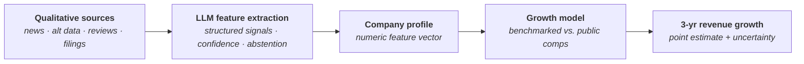

# Qual2Cast

**Forecasting private-company revenue growth from qualitative signals.**
*Columbia University IEOR Industry Capstone, in partnership with Rational AI (Fall 2026).*

Qual2Cast estimates the 3-year cumulative revenue growth of private companies by turning qualitative information (news, hiring activity, contracts, credit stress) into quantitative features that a forecasting model can use. Large language models extract the features, and the extraction is evaluated as a measurable system, not trusted as an oracle.

---

## Ten-company research pilot

[Results and charts](reports/whole_company_pilot/README.md) · [Self-contained notebook](notebooks/whole_company_pilot.ipynb) · [Code and reproduction](experiments/whole_company_pilot/README.md)

The pilot compares 31 ranking variants and peer-valuation alternatives on ten development companies. Default replay uses embedded saved model outputs. It is an independent research contribution; comparison with the latest matching branch and independent human validation remain pending. See the [handoff](conversations/2026-10-19-whole-company-pilot.md) for scope and verification.

## Why

Private companies don't publish audited financials, so investors often have little hard data to forecast their growth. They do leave a trail of qualitative evidence:

- New contracts, product launches, and aggressive hiring → likely **positive** momentum
- Difficulty servicing debt, layoffs, and customer churn → likely **negative** momentum

Qual2Cast tries to systematically identify which of these signals actually predict growth and how strongly.

## Approach

1. **Signal collection.** Gather qualitative data on each company from news, alternative data, and consumer-facing sources.
2. **Feature extraction.** LLMs convert unstructured text into structured, scored growth signals. Low-confidence cases are routed to abstention or human review.
3. **Company profiling.** Map features onto a common numeric scale so companies can be compared by similarity.
4. **Forecasting and valuation proxy.** Train on public companies, where revenue outcomes are observable, and use comparable companies to anchor growth and EV/EBITDA estimates.

## Evaluation

The LLM components are treated as a system under test:

- Held-out companies and time-based splits to prevent look-ahead bias
- Error categories for extraction failures
- Abstention rules for low-evidence cases
- Human review of a sampled audit set

## Repository layout

| path | contents |
|---|---|
| `AGENTS.md` | working rules for Codex / Claude Code sessions (and people) |
| `PROJECT_STATE.md` | current decisions, status, next steps |
| `conversations/` | handoff notes and exported AI conversations, per task |
| `docs/` | data dictionary, data issues log |
| `src/` | shared code (data snapshot loading and corrections) |
| `data_manifest.json` | which data snapshot the code needs, with checksums |
| `website_scrape/` | collects each company's website text (name + website only), with financial and public-company information filtered out |
| `growth_signals/` | pipeline for dated growth events and leakage-safe features; separate from the company-description scrape |
| `matching/` | comparable-company matching: three methods (embedding similarity, mutual kNN / clusters, agglomerative tree) in `matching_methods.ipynb`, scored in `matching_evaluation.ipynb`; see `matching/README.md` |
| `scraps/` | earlier attempts kept for reference (Codex profiles, first matching pass, first collection script); not part of the pipeline |
| `data-local/`, `outputs-local/` | data and outputs; only the input snapshots and current website text (`page_text/`) are in Git |

## Status

🚧 Early development. Structure, data sources, and methodology are being defined.

## Deliverables

- Reproducible data pipeline and analysis
- Concise technical report
- Presentation of methods, findings, and limitations

## Acknowledgments

Developed under the guidance of Aziz Lookman, founder of Rational AI.
