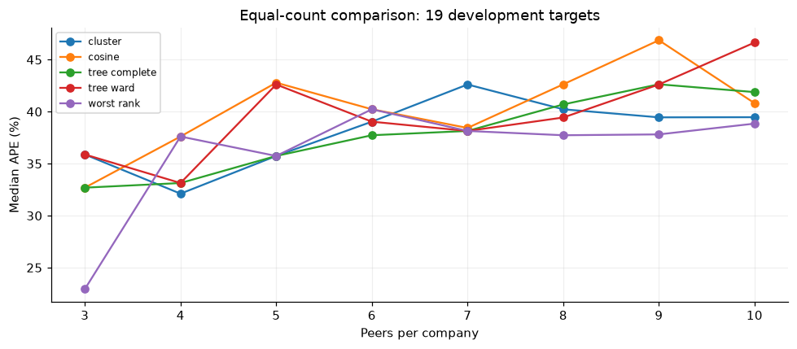
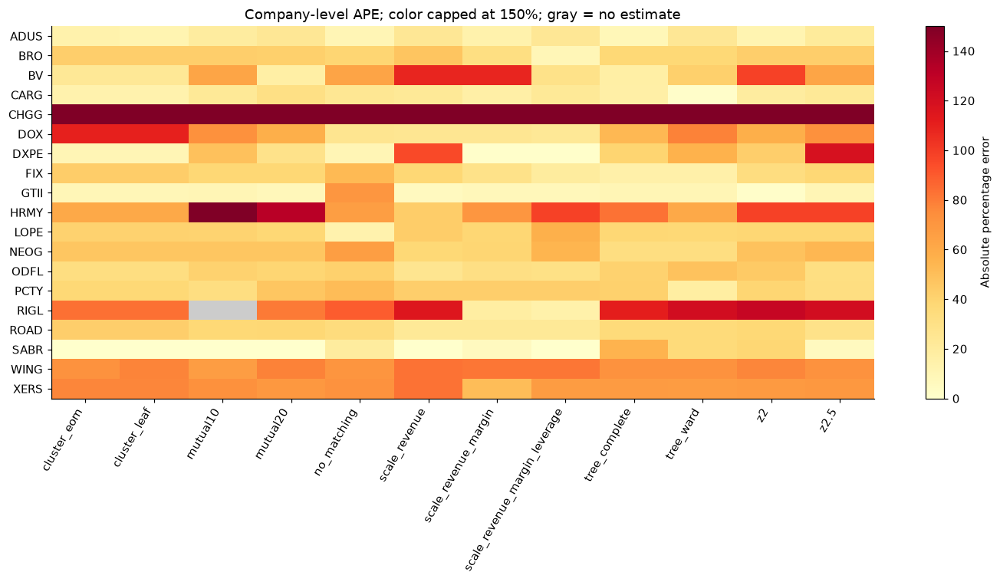

# Integrated company analysis: 19 development targets

[Notebook](../../notebooks/integrated_company_analysis.ipynb) · [Execution notes](../../experiments/integrated_company_analysis/README.md)

The two ten-company lists overlap on PCTY. This report brings the current team
website, matching, valuation and growth-event stages into one reproducible
entry point, retaining the earlier methods as separately labeled comparisons.

| Experiment | Candidate pool | Scope |
|---|---:|---|
| Primary matching and valuation | 535 | 134 configurations; all 19 targets |
| Representation comparison | 529 shared companies | 56 configurations; all 19 targets |
| Activity/profile comparison | Conditional 190-company pool | 18 configurations; 18 eligible targets |
| Growth evidence | 19 targets attempted | 55 current articles; three extractor arms |

## Findings

- Scale reranking reduces median APE from 42.63% to 23.86% on the 19 targets,
  but its paired interval includes zero and incorrect business matches remain.
- On the separate common-529 comparison with five peers, LSA gives 29.13%
  median APE versus current MPNet's 37.32%. This remains a development finding.
- Activity methods change the median/mean tradeoff; they do not establish a
  uniformly better method. DOX extraction fails and is not silently excluded.
- Strict source and availability gates leave one current growth candidate,
  with an unresolved attribution concern. No validated growth forecast exists.

## Review and validation

The notebook reruns 33 code cells without errors and produces five figures.
Fourteen new boundary/parity tests pass; the team main and recall suites pass
96 and 169 tests respectively. Cached embeddings, profiles and cluster labels
are distinguished from rerun selection, valuation, extraction and feature logic.

The 221-pair priority sheet supports initial review; the 1,062-pair full sheet
pools top-ten candidates across all current ranking arms. Independent labels,
aligned financial dates and historical predictor/outcome panels remain missing.
Tests and error reductions do not establish economic validity.
