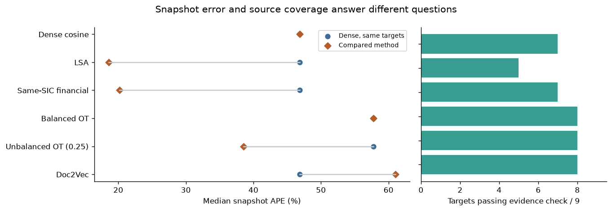
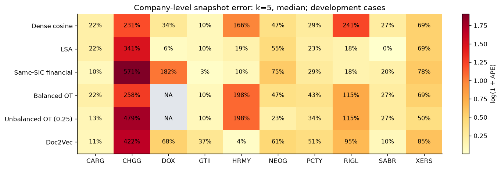
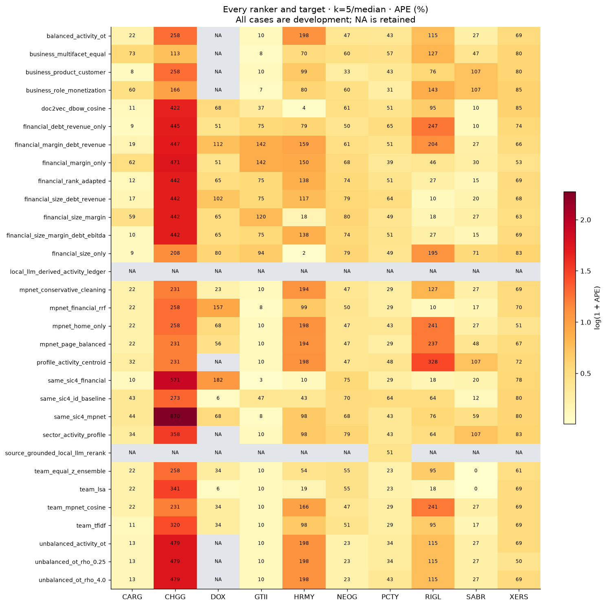
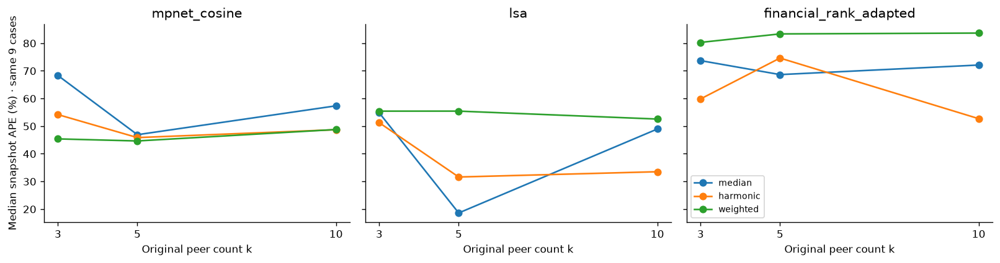

# Whole-company comparables: 10-company pilot

**Start:** [research notebook](../../notebooks/whole_company_pilot.ipynb) · [code and run instructions](../../experiments/whole_company_pilot/README.md)

Each ranking variant has its own mechanism, rationale, citation, executable result cell, all-ten-company peer/error table and finding. The notebook also documents every cleaner, financial/business factor group, aggregation, direct model, evaluation layer and growth route. Default Run All reproduces the saved-output analysis offline. Full model inference is a separate opt-in workflow.

## Principal findings

- Business scope matters: PCTY–ADP shares activities with important differences; CHGG–BLKB illustrates misleading topical overlap.
- On nine non-PCTY development cases at k=5/median, LSA median snapshot APE is 18.56% versus dense 46.87%. Four cases improve, three tie and two worsen; evidence checks pass 5/9 versus 7/9.
- Conservative cleaning leaves median error unchanged but reduces mean error. Same-SIC financial and low-penalty unbalanced OT improve median error while worsening mean error.
- Dense harmonic aggregation at k=5 reduces mean APE from 93.98% to 62.62%; LSA responds differently. Neither current local LLM protocol supports automatic peer approval. No general winner is established.
- Human peer review is pending; financial dates/definitions are unconfirmed. Growth features replay, but no validated three-year forecast or calibrated interval is available.

## Results and further evaluation

The experiment covers 31 ranking variants, 279 compatible peer-count/aggregation configurations and four separate direct predictors. All ten targets are development cases; the candidate pool is 183 companies.

- [All configurations](tables/configuration_results.csv) and [direct predictors](tables/direct_configuration_results.csv).
- [Every method's source, adaptation and code location](tables/method_evidence.csv).
- [Full method comparison](figures/paired_snapshot_error.png) and [all-company heatmap](figures/target_sensitivity.png).
- [Human-review rubric](review/HUMAN_REVIEW_RUBRIC.txt) and [two](review/reviewer_1_template.csv) [forms](review/reviewer_2_template.csv).

Next: complete named independent reviews, align financial definitions/dates, freeze choices and test new companies. The notebook contains the source data; separate code supports inspection and integration. No existing team module is replaced by this additive package.
