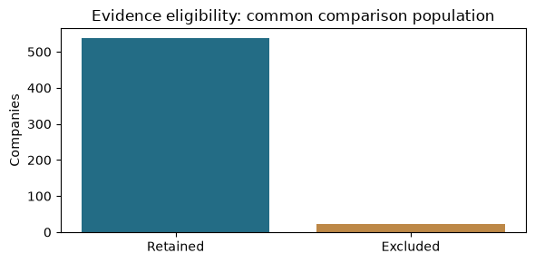
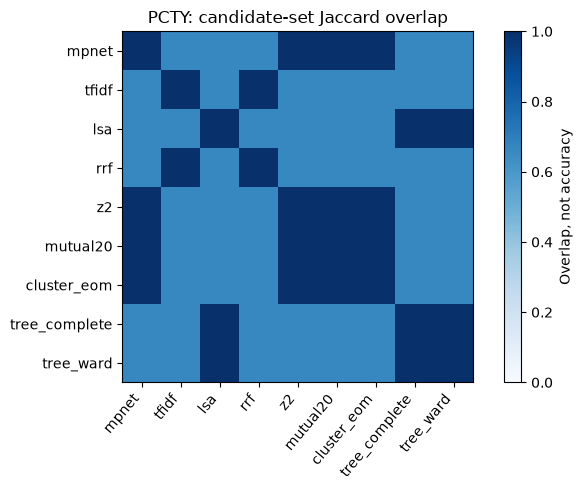
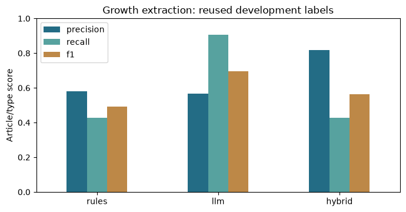
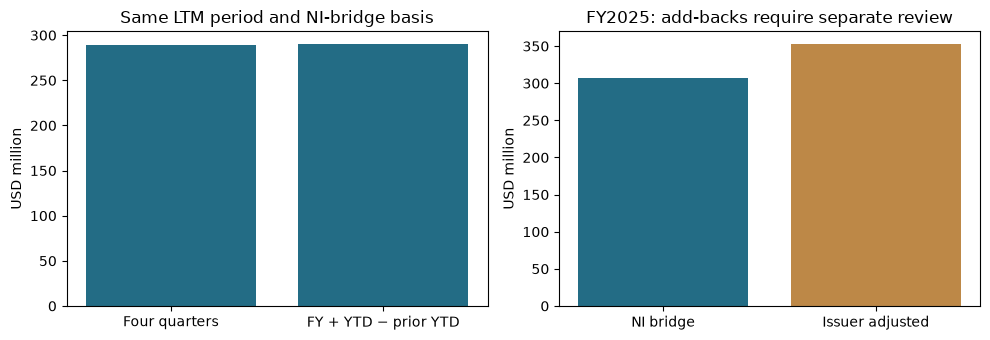
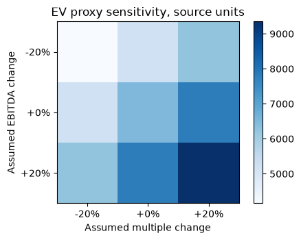
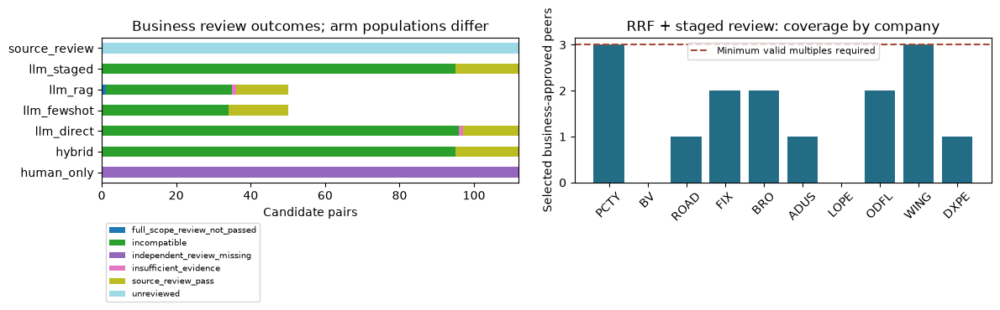
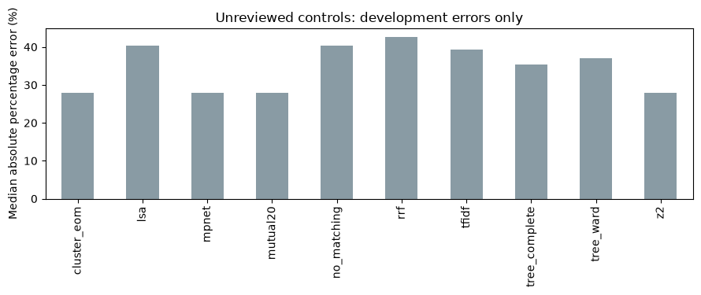
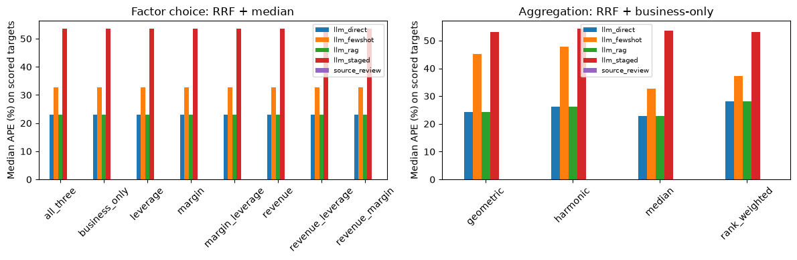

# Integrated company workflow: results

The [notebook](../../notebooks/team_company_workflow.ipynb) follows the full workflow
and includes each method's procedure, citations, code and results. It is about
21 MB because it embeds evidence, source modules and recorded model responses.
Download it if GitHub cannot render the preview. The [module guide](../../pipeline/TEAM_WORKFLOW.md)
provides setup and extension instructions.

## Scope and findings

The evidence policy retains 538 of the sponsor's 560 companies. Ten previously
inspected team targets are development cases. The fixed-budget experiment contains
672 configurations and 6,720 target/configuration rows, not 6,720 independent tests.

| Component | Observed result | Interpretation |
|---|---|---|
| Business review | 324 source-checked judgments across direct, staged, few-shot and RAG methods | Quotation/hash checks establish provenance; correctness still needs independent labels. |
| Progressive PCTY search | 537 ranked candidates; 50 reviewed; PAYC, ASUR and ADP accepted automatically; 487 unreviewed | Continue down the ranking within the chosen budget; do not force ten peers. |
| Fixed-budget valuation | Default RRF/staged/business-only/median estimates 2/10 targets: PCTY APE 22.9%, WING 84.4% | Report coverage with error; no demonstrated improvement over the team's baseline. |
| Financial factors | Factor choice changes estimates in 58 of 116 groups with any estimate | Effects depend on the selected peers and aggregator; no universal winner. |
| Growth extraction | Rules P/R 0.581/0.429; LLM 0.567/0.905; intersection 0.818/0.429 | The LLM recovers more events; agreement improves precision on reused development labels. |
| EBITDA | BrightView four-quarter and FY+YTD LTM routes yield $289.7m/$289.8m | Arithmetic example only; issuer add-backs and financial alignment need review. |

The progressive ten-peer search is separate from the fixed experiment's five-candidate
shortlist and three-peer maximum. Results from these designs are not interchangeable.
Human-review CSVs are blank templates. There is no validated growth forecast or
verified private-company fair value. Names may remain in website text; this is not
a fully identity-blind evaluation.

## Files

- `*_method_evaluation.csv`: matching, factor and valuation comparisons.
- `paired_method_evaluation.csv`: differences on common estimated cases, with coverage.
- `control_evaluation.csv`, `growth_evaluation.csv`: control and event-extraction scores.
- `PCTY_ranked_candidates.csv`, `PCTY_selected_peers.csv`: full ranked search and accepted peers.
- `independent_human_review.csv`, `PCTY_independent_human_review.csv`: uncompleted review queues.
- `field_selection.csv`: field choice, source and target/peer availability.
- `comparison_scope.json`, `delivery_audit.json`, `VALIDATION.json`: scope, status and reproducibility checks.

All 6,720 detailed results are embedded in the notebook and recomputed by its
comparison section. Validation completed 294 tests and 17 notebook code cells,
with zero errors and eight figures. Default replay makes no fresh inference calls.

## Figures

Evidence population:

Candidate overlap across retrieval methods:

Growth extraction on reused development labels:

EBITDA measurement example:

Valuation sensitivity:

Business-review decisions and valuation coverage:

Control valuation errors:

Factor and aggregation comparisons:

