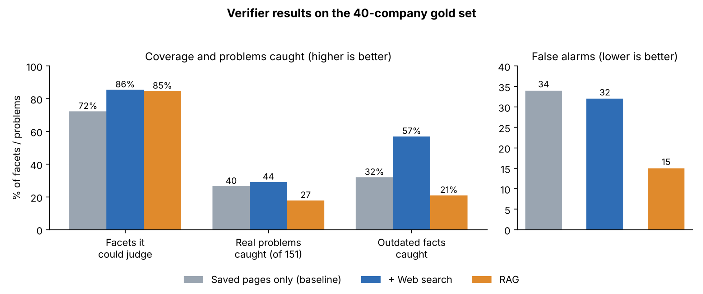

# Describing a company {#sec-describing}

```{python}
#| include: false
from IPython.display import Markdown
from facts import common as F
from facts import ch3_describing as f
```

::: {.as-of}
Results as of `{python} F.AS_OF`.
:::

::: {.prose-todo}
**To write** · draft owner: Richard; checked by Fiona (assignments are open, see `site/README.md`)

Scope: the 12 business-model facets and the economic traits E1-E10, how they are filled and checked.

Facts available:

- `f.n_facets` = `{python} f.n_facets`: general facets per company
- `f.facet_names` = `{python} f.facet_names`: their names, F1 to F12
- `f.facet_share_model` = `{python} f.facet_share_model`: facet values from model knowledge (of values with a recorded source)
- `f.n_facet_values_web` = `{python} f.n_facet_values_web`: facet values citing the website
- `f.n_facet_web_companies` = `{python} f.n_facet_web_companies`: companies with at least one website-sourced value
- `f.n_facet_unknown` = `{python} f.n_facet_unknown`: facet values left unknown
- `f.n_tags` = `{python} f.n_tags`: tags (T1-T4)
- `f.n_traits` = `{python} f.n_traits`: economic traits (E1-E10)
- `f.n_traits_filled` = `{python} f.n_traits_filled`: companies with both trait rounds filled
- `f.trait_unknown_max` = `{python} f.trait_unknown_max`: highest unknown share of any trait (full fill)
- `f.n_trait_known` = `{python} f.n_trait_known`: companies the model said it knew (round 1)
- `f.n_trait_pages` = `{python} f.n_trait_pages`: companies whose trait prompt had saved page text (a page title counts)
- `f.trait_test_n` = `{python} f.trait_test_n`: companies in the double-fill test
- `f.trait_flips_max` = `{python} f.trait_flips_max`: most flips of any question between the two test fills
- `f.trait_flip_share` = `{python} f.trait_flip_share`: flips over all answers compared (tags and traits, both rounds)
- `f.trait_test_unknown_max` = `{python} f.trait_test_unknown_max`: most unknowns of any question in a test fill
- `f.trait_keep_flip_max` = `{python} f.trait_keep_flip_max`, `f.trait_keep_unknown_max` = `{python} f.trait_keep_unknown_max`: keep rule (a question above either is reworded or dropped)

Figures available:

- @tbl-facets: the twelve facets (02 notebook, section 3.1)
- @fig-trait-rates: yes / unknown / no share per trait, full fill
- @tbl-traits: every tag and trait, its question, answers and test flips
:::

```{python}
#| label: tbl-facets
#| tbl-cap: "CAPTION TODO"
Markdown(f.facets_table().to_markdown(index=False))
```

```{python}
#| label: fig-trait-rates
#| fig-cap: "CAPTION TODO"
#| fig-alt: "ALT TODO"
fig = f.trait_rates_figure()
```

```{python}
#| label: tbl-traits
#| tbl-cap: "CAPTION TODO"
Markdown(f.traits_table().to_markdown(index=False))
```

<!-- Word for word from the team's 10/28 note to Aziz ("10/28 Note: Qual2Cast v0", its PDF export), sections 2, 3, 5
     and 8; Figure 5.1 is the note's own image. Not edited: the wording and numbers are the note's own, so check.py does
     not look for typed numbers in an .excerpt. -->
::: {.excerpt}
[10/28 Note: Qual2Cast v0]{.excerpt-source}

## 2. Facet Curation {#v0-2 .unnumbered .unlisted}

| ID  | facet                                | what it captures                                | example values                                                                       |
|-----|--------------------------------------|-------------------------------------------------|--------------------------------------------------------------------------------------|
| F1  | offering_description (core offering) | what it sells and to whom, as its own site says | Designs and manufactures rooftop HVAC units for commercial buildings                 |
| F2  | primary_products                     | main products sold                              | HR software; medical devices; hot-mix asphalt                                        |
| F3  | primary_services                     | main services delivered                         | consulting; freight logistics; payroll processing                                    |
| F4  | customer_segment                     | who buys                                        | B2B: mechanical contractors, commercial building owners; B2G: school districts       |
| F5  | end_markets                          | industries served                               | healthcare; retail; manufacturing                                                    |
| F6  | revenue_model                        | how it earns revenue                            | product sales: equipment sold through dealers; service fees: installation and repair |
| F7  | value_chain_position                 | role in the industry                            | OEM / manufacturer: builds HVAC units from purchased components, sold to contractors |
| F8  | geography_served                     | markets of operation                            | US regional: Alabama, Florida, Georgia and the Carolinas                             |
| F9  | company_size\*                       | scale within its own industry                   | mid-sized                                                                            |
| F10 | specialization                       | breadth of offerings                            | related lines: HVAC units, controls and replacement parts                            |
| F11 | distribution_channels                | how products reach customers                    | distributors / dealers: independent HVAC dealers; direct sales: national accounts    |
| F12 | regulatory_exposure                  | importance of regulation                        | high: medical devices that need FDA clearance                                        |

: Table 2.1: Facet List – Inspired from schemas of popular financial databases including Orbis, Preqin, CapIQ, Bloomberg Terminal, and alternative sources from WRDS

## 3. LLM-Based Population {#v0-3 .unnumbered .unlisted}

The next step from here was to populate these facets:

- Sol and Haiku struggled to fill out the field for capital intensity → we decided to drop it until we obtained data to cross-reference it with
- Fiona’s thought: first calculate the facet as fixed assets ÷ total assets and then reclassify the results under three bands (under 15% is light, 15–40% medium, over 40% heavy), but this idea delves into quantitative-esque approaches
- Ultimately, a facet such as this one poses a greater fundamental design issue which we will specify in [Open Question (OQ) #2.3](limits.qmd#v0-oq-2-3).

## 5. Facet Golden Set {#v0-5 .unnumbered .unlisted}

Richard, Fiona, and Riya hand-checked Haiku’s fills for all 12 facets across 40 companies, using the company website and other sources. Each fill was labeled as either correct, partly correct, outdated, wrong, or can’t tell. Company size had the most errors (maybe this can be removed from the facet list). Yiming also expanded on our facet fills by finding a way to directly validate them using Google search or by re-viewing the website. He then built [v0/verification/](https://github.com/Qual2Cast/Qual2Cast/tree/main/v0/verification), which collects outside evidence from more of the target company’s own site plus web search (with investor and stock sites blocked). Using our labels to test Yiming’s verifier, Richard first made the labels consistent with the repo:

- At the start, our labels + fills saved in the repo matched on only 41 of 480 facets, so the verifier could not be scored.
- The gold set became a benchmark of 40 companies, 477 facets, and 151 real problems that scored the verifier with one command —> showed that one rule caused most false alarms: the verifier flagged every “partly correct” fill as a problem.
- Fixing the above raised agreement with our labels from 40.9% to 85.7% (tested on 2 companies so far).

We then added a RAG step to the verifier to pull passages most related to each facet. This graph compares it with the two existing setups on all 40 companies: the saved website pages only (baseline), and the saved pages plus web search.

{fig-alt="ALT TODO"}

Web search lets the verifier judge more facets (72% → 86%) and catches more outdated facts (32% → 57%), mostly businesses a company had already sold. RAG cuts false alarms by more than half (34 → 15), but it catches fewer real problems (40 → 27), because it drops the search results and the lines about sold businesses. No setup catches more than 30% of the real problems yet, and none catch company size errors.

Next, we will combine search with RAG and confirm the rule fix on all 40 companies. Our source-backed business-structure check from Eric keeps each company as one valuation entity, groups related products, and removes documented divestitures. Across the 40 development companies, the check classified 33 as single-business entities and 7 as multi-business entities. He also ran it through the existing v0 peer-selection and valuation workflow on the same 10 targets. Adding the full business scope changed 10 of 142 peer judgments, but reduced targets with matched peers from 7 to 4; median absolute percentage error rose from 29.21% to 32.10% with the existing no-matching fallback, so the split is useful for checking company scope.

## 8. Specialized Sub-Models {#v0-8 .unnumbered .unlisted}

Fiona attempted to improve on the eval findings by mapping each firm's SIC4 code to a Fama-French 49 industry (FF49). Each FF49 industry then maps to one of 11 sector groups, such as software, manufacturing or consumer venues. From there, every firm gets one more text facet, its niche in a few words. The category facets are then compared by overlap and only between two firms of the same sector group. This is calculated by dividing the size of the intersection of two sets by the size of their union (Jaccard similarity coefficient). Across groups, the facet is left out of the pair, like an unknown facet. Everything uses equal weights, see point 4 in [#10. Assumptions and Limitations](limits.qmd#v0-10).

| Variant                    | Pairwise Ranking Accuracy |
|----------------------------|---------------------------|
| Generic facets             | 0.899                     |
| + SIC4 sub-sector          | 0.911                     |
| + FF49                     | 0.895                     |
| Same-sector-only sub-model | 0.78–0.79                 |

: Table 8.1: Sub-Sector vs Same Sector Sub-Model

In the table above, Fiona found that FF49 as a comp facet doesn’t help: it’s too broad and overlaps with products and end markets. A sector sub-model hurts (0.785), since many good comps sit in another sector like PCTY vs ADP. However, a finer sub-sector does help (0.911).

| Route            | General (coverage, error) | + sector facets | Paired median change (95% bootstrap interval)           |
|------------------|---------------------------|-----------------|---------------------------------------------------------|
| Cosine z ≥ 2     | 160, 37.32%               | 160, 34.97%     | −1.94 points (−3.81 to +0.25); 91 improved, 69 worsened |
| Binary judge     | 110, 37.95%               | 114, 32.82%     | 0.00                                                    |
| Direct LLM       | 119, 33.78%               | 117, 34.00%     | 0.00                                                    |
| LLM then cosine  | 119, 33.78%               | 117, 33.78%     | 0.00                                                    |
| Graded, 2 only   | 116, 37.18%               | 120, 34.80%     | 0.00                                                    |
| Graded, 2 then 1 | 155, 37.32%               | 156, 36.64%     | −0.02                                                   |

: Table 8.2: Sub-Sector Model Performance
:::
