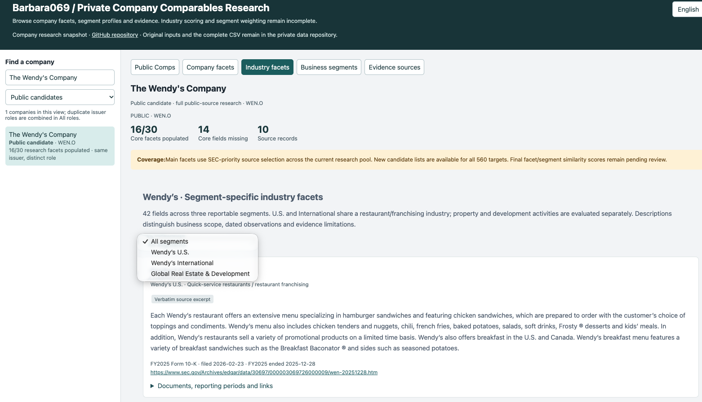
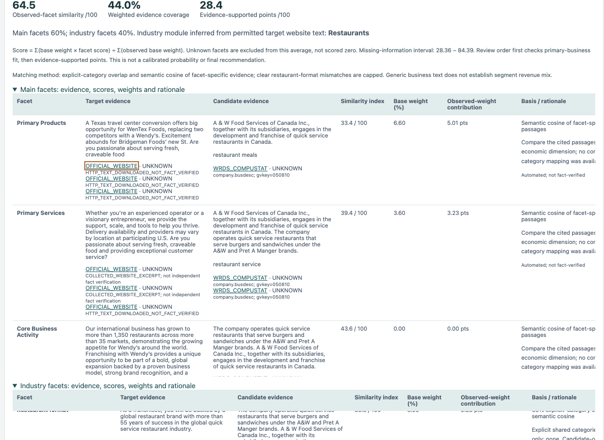

# Finding comps {#sec-finding}

```{python}
#| include: false
from facts import common as F
from facts import ch4_finding as f
```

::: {.as-of}
Results as of `{python} F.AS_OF`.
:::

::: {.prose-todo}
**To write** · draft owner: Kethan (assignments are open, see `site/README.md`)

Scope: the B3 list, the selector and the agent grade, described directly (no single-target walk-through).

Facts available:

- `f.b3_targets` = `{python} f.b3_targets`: training targets with a B3 list
- `f.b3_pairs` = `{python} f.b3_pairs`: B3 pairs (target, comp), all training targets
- `f.b3_k` = `{python} f.b3_k`: k of the list rule (mutual top k)
- `f.b3_min_comps` = `{python} f.b3_min_comps`: smallest list (lists topped up to this)
- `f.b3_median_comps` = `{python} f.b3_median_comps`: median comps per target on the B3 list
- `f.b3_pairs_topped_up` = `{python} f.b3_pairs_topped_up`: B3 pairs added by the top-up (not mutual)
- `f.sel_kept_pairs` = `{python} f.sel_kept_pairs`: B3 pairs the selector keeps, all training targets
- `f.sel_keep_rate` = `{python} f.sel_keep_rate`: share of B3 pairs the selector keeps
- `f.sel_targets_kept` = `{python} f.sel_targets_kept`: targets with at least one comp kept by the selector
- `f.sel_targets_no_comp` = `{python} f.sel_targets_no_comp`: targets the selector leaves with no comp
- `f.agent_targets` = `{python} f.agent_targets`: targets the agent graded (the reviewed targets)
- `f.agent_pairs` = `{python} f.agent_pairs`: pairs the agent graded (their full B3 lists)
- `f.agent_grade2` = `{python} f.agent_grade2`: agent grade 2 (direct peer)
- `f.agent_grade1` = `{python} f.agent_grade1`: agent grade 1 (adjacent)
- `f.agent_grade0` = `{python} f.agent_grade0`: agent grade 0 (not a peer)
- `f.agent_insufficient` = `{python} f.agent_insufficient`: agent found too little evidence (no grade)
- `f.agent_ge1` = `{python} f.agent_ge1`: agent grade 1 or 2
- `f.agent_max_steps` = `{python} f.agent_max_steps`: most steps the agent may take per pair
- `f.agent_pairs_lookup` = `{python} f.agent_pairs_lookup`: pairs where the agent looked something up (site or web search)
- `f.agent_share_lookup` = `{python} f.agent_share_lookup`: share of pairs with a look-up
- `f.sel_kept_on_agent_pairs` = `{python} f.sel_kept_on_agent_pairs`: selector keeps on the same pairs the agent graded

Figures available: @fig-filter-keeps (pairs kept by each filter, same pairs), @fig-agent-outcomes (agent grade counts)
:::

```{python}
#| label: fig-filter-keeps
#| fig-cap: "CAPTION TODO"
#| fig-alt: "ALT TODO"
_ = f.fig_filter_keeps()
```

```{python}
#| label: fig-agent-outcomes
#| fig-cap: "CAPTION TODO"
#| fig-alt: "ALT TODO"
_ = f.fig_agent_outcomes()
```

<!-- Word for word from the team's 10/28 note to Aziz ("10/28 Note: Qual2Cast v0", its PDF export), sections 4, 4.1
     and 9; the two screenshots are the note's own images. Not edited: the wording and numbers are the note's own, so
     check.py does not look for typed numbers in an .excerpt. -->
::: {.excerpt}
[10/28 Note: Qual2Cast v0]{.excerpt-source}

## 4. Company Profiles {#v0-4 .unnumbered .unlisted}

From here, we [readapted our original methods](https://github.com/Qual2Cast/Qual2Cast/blob/main/v0/notebooks/comps_and_valuation.ipynb) to construct a company profile. We initially started with a 70/30 train-test split stratified on the ‘company size’ facet, but later revised the holdout stratification to use SIC2 codes instead. Despite needing some extra reruns, most of our pre-v0 work remained the same:

I.  Turn the descriptions / qualitative features / facets into an embedding space. See point 1 in [#10. Assumptions and Limitations](limits.qmd#v0-10).
II.  Find the cosine similarity scores of those embeddings to get companies that ‘sound alike’ to the target. Scored between 0 and 1
III.  Filter our highest-scoring target-comp pairs: find those that have a z-score > t, where t is some arbitrary threshold (in our case, z = 2, 2.5)
IV.  From that basic pair-set, use a base LLM to infer the best comps and finalize the profile

### 4.1. Results {#v0-4-1 .unnumbered .unlisted}

We experimented with different combinations of the above flow to form the final list of good comps using purely cosine similarity, only LLMs, both in different orders, and even without any matching method. In early results, we found that regardless of the selected approach, each baseline maintained \~30% error between the target company’s evx and the weighted average evx of the comps. Even with these results, our primary focus is on developing and analyzing meaningful facets, so baseline performance on the training data is currently a secondary consideration .

At the end, we performed the SIC2-holdout evaluation for all 160 companies and compared the four existing comp-selection routes on the 107 targets they all covered. We also evaluated the peer ratings ([#6. Human: Comp Golden Set](judging.qmd#v0-6)), tested removing the primary-services facet (F3), and checked 40 companies for multiple businesses under one company ID. The facet change improved peer ranking but had no robust holdout gain (cosine error: 37.32% → 33.29%, paired-change interval: −2.04 to +0.08 points). Using the business groupings described in [#5. Facet Golden Set](describing.qmd#v0-5) did not improve matching: median error went from 19.26% to 39.41% on ten development targets, and 31.02% to 40.21% on six holdout targets.

## 9. Separate Branch - Barbara {#v0-9 .unnumbered .unlisted}

Developed a parallel research pipeline to explore alternative approaches to comparable-company selection, data coverage, and methods.

**Interactive Website:** [https://barbara069.github.io/private-company-comparables-research](https://barbara069.github.io/private-company-comparables-research/?company=IQ23557&view=comps)

(1) Expanded the universe beyond the original 560 firms to \~30,000 global public companies candidates
(2) Used Codex to retrieve and compile a company database (a large CSV file) using Capital IQ, WRDS API, LSEG API, SEC API, company websites, google search. Try to fill out for all company universe:
    - \(1) General Facets
    - \(2) Industry-specific facets
    - \(3) Business Segment of each Company
(3) With every text data filled, the agent must provide sources and link, cross-validation across different sources, and flagged discrepancies.
(4) Treat each 560 target as pseudo private (only source allowed is website, revenue, EBITDA, and debt) to implement preliminary facet-based similarity scoring. Find its top 10 public comps from the 30,000 universe.

The goal is to evaluate this method independently and see if the results could be improved compared to the group’s pipeline.

**Next Step:** Cross-source validation, continue to fill out industry & segment-specific facets, try out different similarity scoring methods, then fetch financial data to do revenue & growth prediction. Split 75% Training + 25% Unseen Testing data for better scoring.

**Challenge:** The data fetching process could be a lot easier if we have access to Bloomberg API or Capital IQ API. Now it heavily relies on the current database providers listed above. But the SEC source is deemed more reliable when a discrepancy is identified.

{fig-alt="ALT TODO"}

{fig-alt="ALT TODO"}
:::

::: {.callout-note}
::: {.prose-todo}
**To write: the "how we got here" box** · draft owner: Kethan

Scope: v0 compared four ways of choosing comps by valuation error and none clearly won (the 10/28 note, quoted
above), so the project switched to scoring comp quality against reviewers. A few sentences, not a history chapter.
Why v1 gets little space is already said at the end of @sec-intro.

Facts available:

- `f.v0_routes` = `{python} f.v0_routes`: comp-choosing routes compared in v0
- `f.v0_holdout_targets` = `{python} f.v0_holdout_targets`: v0 holdout targets scored
- `f.v0_common_targets` = `{python} f.v0_common_targets`: holdout targets every route gave an estimate for
- `f.v0_err_no_matching` = `{python} f.v0_err_no_matching`: no matching, median absolute % error of EV/EBITDA (same targets)
- `f.v0_err_routes_range` = `{python} f.v0_err_routes_range`: the four routes, median absolute % error (same targets)
- `f.v0_routes_differing` = `{python} f.v0_routes_differing`: routes whose paired 95% interval vs cosine excludes 0
- `f.v0_paired_change_range` = `{python} f.v0_paired_change_range`: span of those paired intervals (route minus cosine)
:::
:::
