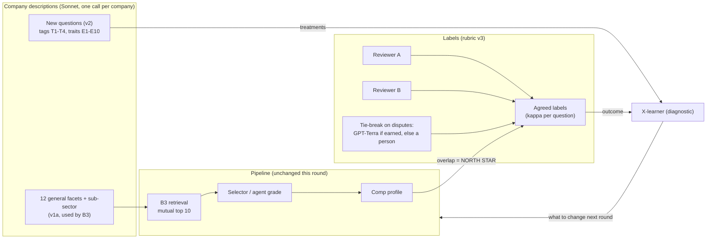

# How the evals fit together (v2)

**For:** the whole team: the eval group (Barbara, Matthew), the model-improvement group (Kethan, Riya, Fiona,
Yiming) and the website/presentation group (Kethan, Eric, Richard, Michael). Decided by Michael on 2026-11-24 in a
design session; where this file and older docs differ, this file wins for v2.

## 1. What we are optimizing

**The product is a target's comp profile: the short list of public comps the pipeline keeps for it.** A better
pipeline is one whose comp profiles agree more with what trained reviewers pick, on targets it was not tuned on.

Three numbers, in this order of authority:

| | number | what it answers | used for |
|---|---|---|---|
| 1 | **Cohen's kappa between reviewers**, per rubric question | can the labels be trusted at all? | deciding which labels count as truth |
| 2 | **Overlap** of the comp profile with the agreed labels | did the pipeline get better? | **the north star**: the headline result |
| 3 | **X-learner lift** per facet or trait | which business characteristics separate peers from non-peers? | deciding what to change next (a diagnostic, never the headline) |

EV/EBITDA error is reported **once**, at the end, as context. Nothing is tuned on it, and it never enters comp
finding.

**Overlap**, precisely: on labelled pairs only (an unlabelled pair is never counted as a non-peer),
- *precision* = share of the pairs the pipeline keeps that reviewers call peers, and
- *recall* = share of the reviewers' peers that the pipeline keeps,

each for **any peer** (score 1 or 2) and for **direct peer** (score 2), averaged over targets. Report both precision
and recall; a single blended number can be gamed by keeping everything or nothing.

**Tracking it:** every pipeline version's overlap goes in the improvement ledger
([`09_analysis/PROGRESS.md`](09_analysis/PROGRESS.md)): one row per change, append-only, with the label set and the
targets it was scored on. `latest.csv` and `progress.png` (in `outputs-local/v2/09_analysis/progress/`) are what the
website shows; `analysis.ipynb` section 3.3 shows the same. Baseline (2026-11-24, Matthew's v2 labels, target means):
the selector keeps 92% peers but only 34% of them; the agent grade ≥ 1 keeps 72% of peers at 79% precision.

**Why kappa comes first.** On the current labels, Barbara and Matthew agree at kappa 0.19 (almost all of it on what
"adjacent" means). A pipeline tuned to agree with one person at kappa 0.8 has learned that person's taste, not what a
peer is. Overlap only means something against labels two people agree on.

## 2. Two lists: what defines a peer vs what we test

Every characteristic sits on exactly one of two lists.

- **Definition list:** what *makes* a pair peers. These are the rubric questions: same product, same customers, same
  revenue model, same chain step. They decide the 0/1/2 score.
- **Test list:** what we *test* as an explanation of peers: the economic traits E1-E10 (round 1: E1-E6; round 2:
  E7-E10) and the 12 general facets.

A characteristic is never on both. **Why:** if "same recurring revenue?" were a rubric question, the X-learner would
"discover" that recurring revenue predicts peers, because we wrote it into the definition. That is the circularity
we avoid. A new facet gets put on one list before anyone tests it.

Consequence for reading the current X-learner results: some of the 12 general facets mirror definition questions
(customer segment is close to "same customers", primary products to "same product"). Their lift (+21 and +15 points)
shows that Sonnet's descriptions agree with what reviewers judged, which is a **check on the fills**, not a finding.
Only lift on test-list characteristics counts as a finding.

Three guards keep the test honest:
1. **One list per characteristic** (above).
2. **Different sources on each side.** The outcome (peer or not) comes from people; the treatment (do the two
   companies match on a trait) comes from Sonnet's separate description of each company. Reviewers never answer
   trait questions, and Sonnet never grades pairs for this test.
3. **An overall call first.** Before the four rubric questions, each reviewer answers yes/no: "Would you put this
   company in the target's comp set?" The 0/1/2 score is a formula; if the formula is off, every result inherits it.
   The overall call is the reviewer's own first impression of the whole pair, from the same evidence as the four
   questions (not from the facets). A trait that shows lift on both the formula score and the overall
   answer is not an artifact of the formula.

**What a direct peer is (decided):** same business: same product and same customers. Economic traits are tested,
not assumed. If a trait turns out to separate direct peers strongly, that is the evidence to make it part of the
definition in a later round (and then it leaves the test list).

## 3. The rubric (v3)

Full text, anchor pairs and sheet instructions: [`06_labels/RUBRIC_V3.md`](06_labels/RUBRIC_V3.md). In short:

1. **Overall call:** would you put this company in the target's comp set? (yes/no; a cross-check, never the main
   label). Not to be confused with the sheet being *blind*: reviewers never see the method, rank, similarity,
   multiple or earlier grade of a pair, so the labels can't be shaped by what the pipeline already thinks.
2. **Same product:** can a customer of the target buy the same kind of product or service from the comp instead?
3. **Same customers (tightened):** would the target's own customers consider buying this kind of thing from the
   comp? Same buyers who could switch, not just the same industry or the same payer (a hospice and a neonatal
   physician group are both paid by Medicare, but their patients would never switch: no).
4. **Same revenue model:** does the comp earn money the same way?
5. **Same chain step:** makes it, distributes it, sells it to the end user, or services it?

**Score (computed, never typed):** 2 = yes to all four of 2-5; 1 = yes to product or customers, but not all four;
0 = no to both product and customers. Revenue model and chain step can only turn a 2 into a 1; they never lift a
pair. Each question has an optional "unsure" tick that never changes the answer; unsure ticks are reported next to
kappa to show where wording still needs work.

**Three worked anchor pairs per question** (a clear yes, a clear no, a borderline case with its ruling) are listed by
name in `RUBRIC_V3.md`. Anchor pairs are excluded from scoring.

**What replaced the 12-facet count plan.** The plan to have reviewers answer yes/no on all 12 facets per pair and
map the count to a grade (10-12 direct, 7-9 adjacent, 1-6 not a peer) is dropped, for three reasons:
- a count lets geography, channels and regulation outvote the business itself: on Matthew's sheet, counting 2 of 4
  yeses would have made 38 pairs peers with no product and no customer overlap;
- it puts the facets on both sides of the X-learner test (the circularity in section 2);
- it is about 3,500 answers for 293 pairs instead of about 1,500, and that load is where reviewers drift.
The facet matches still exist: they are computed from Sonnet's company descriptions, not asked of reviewers.

**Reviewers and ties.** Two reviewers answer every pair. Kappa is reported per question on the two reviewers'
answers, before any tie-break. Where they disagree on a question:
- **GPT-Terra** (the LLM judge, `gpt-5.6-terra`) breaks the tie **only on questions where it has earned it**: it
  answers the same sheet for every pair, and it counts as a tie-breaker for a question only if its kappa with the
  reviewers is at least as high as the reviewers' kappa with each other. It reads the companies' websites, not our
  facets, and is a different model family from Sonnet, so it adds no circularity.
- Otherwise a third person breaks the tie.
- Tie-broken pairs are flagged. **The headline overlap is reported on human-agreed pairs**, with tie-broken pairs
  added as a sensitivity row.

## 4. Traits and tags

The new questions per company (ten in round 1, four more in round 2) come in two kinds. They look alike (all yes/no/unknown, all filled by Sonnet in
the same call) but do different jobs.

| | **Tags** (T1-T4) | **Traits** (E1-E10) |
|---|---|---|
| Question | what kind of company is it? | what are its economics? |
| Questions | sells products; sells services; sells to consumers; sells to organizations | round 1: recurring revenue; cyclical demand; big-ticket; people-delivered; large customers; asset-heavy. Round 2: maintenance-led; publicly funded; serial acquirer; mission-critical |
| Applies to | every company; a company can be both (300 of 533 sell products and services) | every company: written to apply to any type, so "not applicable" doesn't exist |
| Used as | a **slice**: which subgroup a *target* belongs to | a **treatment**: whether a *pair* matches (both companies give the same answer) |
| Read on | the target only | both companies of the pair |
| In the X-learner | averages the per-pair effects within a subgroup | the thing whose lift is measured |
| Tested itself? | no: tags mostly restate facets B3 already uses (customer segment, products/services) | yes: they are the test list |

**Why the gates became tags.** Mentor Aziz asked about "facets that only apply to some sub-segments, e.g. product vs
services companies, commercial vs consumer". The first design asked conditional questions behind gates (repeat
purchase only for product companies, and so on). That made every gate change a re-fill and a re-label, and left
each conditional question with too few pairs to measure. Instead, every company answers the same economic questions,
and the sub-segment becomes a slice of the analysis: *"does matching on recurring revenue matter more among services
targets than product targets?"* That is exactly the kind of difference the X-learner is built to estimate. Changing
or adding a slice is a code change, not a re-fill and not reviewer time. Reviewers never see tags or traits.

Nuances:
- **Main, not any.** Tags ask whether products, services, consumers or organizations are among the *main* offerings
  or buyers, not whether the company has any at all. The v1a facets record "any", so the two can differ for a
  company with a small side line.
- **The buyer is whoever chooses and receives**, not who pays: a patient is a consumer even when an insurer pays. A
  brand sold through grocers sells to consumers (the shopper picks the brand) and to organizations (the grocer
  buys it).
- **Software is a product**; implementation and managed IT are services. Banks, insurers, REITs and utilities go
  through "services".
- **Mixed companies answer for the larger part** of the business.
- **Unknown is never a mismatch.** A pair with unknown on either side is left out of that trait's test, and a target
  with an unknown tag is left out of that slice's average.
- **Keep rule:** a question that flips between two fills of the same company for more than 20% of companies, or is
  unknown for more than 20%, is reworded or dropped. Noisy answers pull lift toward zero and hide real effects. The
  30-company test (2026-11-24) passed on every question: at most 2 flips in 30 (asset-heavy), at most 1 unknown.
  Two watch points, confirmed by the full 533 fill: "sells to organizations" is yes for 91% of companies (so only
  "sells to consumers" is a useful slice), and big-ticket (12% yes) and people-delivered (13%) are rare, so few
  pairs may differ on them. The full fill has 0% unknown on every question except large customers (2.1%).
- **Thin slices.** On the current labels, "sells to consumers only" covers 4 targets and "products only" 10. That is
  why slices are two levels each (sells services yes/no; sells to consumers yes/no) and why the X-learner is fitted
  once on all pairs and then averaged by slice, instead of fitted separately inside each slice.

**Round 2 traits (E7-E10, prompt `2026-11-24b`).** Round 1's cyclical demand split true direct peers as often as
non-peers (21.7% vs 20.5% of pairs disagree on it), and the model's reasons showed the two facts that actually
decided its answer. Round 2 asks those directly and adds two private-equity value drivers, in a separate call:
**maintenance-led** (most revenue from repairing, servicing or replacing an installed base, not new builds),
**publicly funded** (most revenue ultimately paid by government), **serial acquirer** (grows mainly by buying
companies) and **mission-critical** (customers face real cost or risk switching away). Same rules as round 1.
First run (2026-11-24, Matthew's v2 labels): mission-critical is the strongest trait of either round (direct peer
+10.6 points, a finding in all 10 of its tests); the other three are rare (4-6% of companies) and could not be
estimated yet. As a round-2 result it is a lead until the rubric v3 rerun confirms it.

**Rounds: iterate freely, test each round on its own.** The facet list is meant to grow as we learn. Each new set of
traits is a *round*: its questions and its test plan are written and committed before it is run, it is corrected
for multiple testing within its own family (round 1: 60 tests; round 2: 40), and the earlier rounds' results stay as
they were run. A round designed after seeing earlier results gives *leads*, not results: a lead becomes a result
when the same plan, unchanged, holds on fresh labels (the rubric v3 consensus). This is what keeps a growing facet
list honest: with enough traits and slices, something always looks significant by chance, and the separate plans,
corrections and confirmation are what tell a real trait from a lucky one.

## 5. The X-learner, and how to trust its numbers

The X-learner estimates, for each pair, how much more likely a pair is to be a (direct) peer when the two companies
match on a trait than when they don't, holding the other characteristics fixed. It only sees pairs B3 already
retrieved, and the treatment is not randomized, so **its lift is an association inside B3's lists, not a cause and
not proof that the pipeline improved**. That is why it is the diagnostic and overlap is the headline.

The trait run is **pre-registered** in [`09_analysis/PREREG_TRAITS.md`](09_analysis/PREREG_TRAITS.md): the traits,
the match rule, the slices, the outcomes and the tests are written down and committed before the run, and every
number is reported, nulls included. The same file reruns unchanged when rubric v3 labels arrive.

Four checks make the numbers trustworthy:
1. **Shuffle (placebo) test.** Each trait's answers are shuffled across companies 1,000 times and the whole
   estimator rerun. That shows how big a lift appears by pure chance on these pairs. The share of shuffles with a
   lift at least as big as the real one is the trait's p-value. (1,000 rather than 200: with 200 the smallest
   possible p-value is 0.005, too large to ever pass the correction below across 60 tests.)
2. **Refit bootstrap.** Intervals come from re-fitting the models on resampled targets. The v1a intervals held the
   fitted predictions fixed, which made them too narrow.
3. **Benjamini-Hochberg correction** (next paragraph).
4. **Two outcomes.** Score-based peer/direct peer, and (with rubric v3) the overall call. A real trait shows up on
   both.

**What Benjamini-Hochberg means.** Each test gets a p-value: the chance of seeing a lift this big if the trait truly
didn't matter. With one test, "p below 0.05" means a 5% chance of a false alarm. But the trait run makes 60 tests
(6 traits × overall and 4 slices × 2 outcomes). If no trait mattered at all, about 5% of them, roughly 3, would
still come out "significant" by luck, and we would not
know which. Benjamini-Hochberg fixes this by ranking all m p-values from smallest to largest, finding the largest
rank k whose p-value is below k/m × 10%, and accepting that result and every smaller p-value. A p-value of 0.048
that would pass on its own fails if it ranks 4th of 10 tests (its limit is 4/10 × 10% = 0.04). The promise is
about the list as a whole: of the traits we call real, we expect at most about 10% to be false alarms. It is less
strict than requiring every single test to be bulletproof (Bonferroni), which on a few hundred pairs would hide
nearly everything, and much safer than reading each p-value on its own.

## 6. Where we stand, and the caveats

**Labels available tonight:** Matthew's rubric v2 answers on 262 pairs (40 targets), one reviewer. These are the
four yes/no questions with the score rule we kept, so they are the right base. Barbara's old 0/1/2 labels are not
used as an outcome. Two caveats:

1. **Single reviewer.** No second person has answered the same rubric, so every number on these labels measures fit
   to Matthew. Results are marked "single-reviewer, v2 wording".
2. **Loose customers wording.** Matthew answered the v2 customers question ("same type of buyer"). 120 of his 262
   pairs are "product no, customers yes" and score 1; under the tightened v3 wording, some become 0. His **peer**
   outcome (1 or 2) is therefore inflated (70% of pairs). His **direct peer** outcome (2) also needs "same product",
   so it is much less affected, and with 60 direct peers it is the best-supported outcome we have. That is why the
   trait run uses direct peer as the **primary** outcome and peer as secondary.

## 7. Course of action

| step | who | what | done when |
|---|---|---|---|
| 1 | Michael | Review the 30-company trait test (two fills, stability table); approve the 533 fill | traits table pinned in `v2/current.toml` |
| 2 | Michael | Commit the pre-registration, then run the trait X-learner on Matthew's v2 labels (direct primary, peer secondary) | results reported as single-reviewer, v2 wording |
| 3 | Barbara, Matthew | Fill the rubric v3 sheet (`outputs-local/v2/06_labels/rubric_v3/rubric_v3_sheet.xlsx`; the question key is at its top). Matthew re-answering the 120 "product no, customers yes" pairs under the tightened wording also measures directly what the wording change does | both column sets complete; `rubric_v3.py check` clean |
| 4 | Michael (approval), then run | GPT-Terra answers the same sheet; per-question kappa vs each reviewer decides where it may break ties | tie-break columns filled |
| 5 | third reviewer | Break the remaining ties | consensus labels saved, per-question kappa reported |
| 6 | Michael | Rerun the pre-registered trait X-learner unchanged on the v3 consensus labels | both runs reported side by side |
| 7 | Kethan, Riya, Fiona, Yiming | Tune the selector/agent prompts against the v3 consensus labels; record each change in the improvement ledger (`progress.py record --keeps <run> --targets <checking half>`; precision and recall, any and direct peer). **Recommended:** fix a tuning half and a checking half of the labelled targets before tuning, and report overlap on the checking half; otherwise the headline is scored on the pairs it was tuned on | overlap on the checking half beats the current pipeline |
| 8 | all | One final check on the locked 24 direct-peer pairs with frozen settings; EV/EBITDA reported once | final numbers in the report |
| 9 | Kethan, Eric, Richard, Michael | Website and slides: this file's sections 1-5 and the diagram are the methodology section | presentable |

If the eval group has time to add labelled pairs, the most useful are targets from the thin slices
(consumer-facing and products-only companies).

## 8. Decided vs open

Decided (2026-11-24):
- North star = overlap with agreed labels; kappa gates the labels; X-learner is the diagnostic; EV/EBITDA once.
- No new run on the 160 holdout targets (no labels, already scored); the locked 24 pairs are the final check.
- B3, the selector and the agent are unchanged this round. The new traits are diagnostic only; a trait goes into
  the selector/agent prompts in a later round only if it earns it.
- Rubric v3 as in section 3; reviewers answer only the overall call and the four rubric questions.
- Tags and traits as in section 4, filled by Sonnet on the subscription CLI.
- The X-learner checks in section 5, pre-registered.

Open:
- Who the third reviewer is. Riya is the default fallback, but she is also in the model-improvement group, which
  tunes against these labels; someone outside that group (Eric or Richard) would keep labelling and tuning separate.
- Whether the tuning/checking split (step 7) is adopted by the model-improvement group.
- Whether any trait earns a place in the definition of a direct peer (rubric v4) or in the selector prompt, after
  the v3 rerun.
- The minor-business rule for multi-business targets (cap at 1 or 0), carried over from rubric v2.
